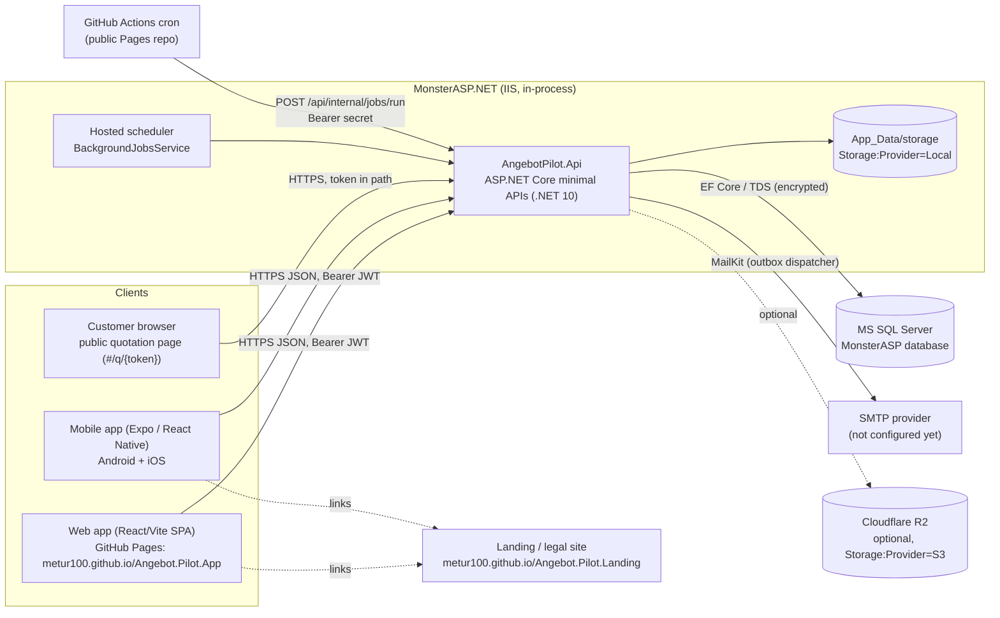

# AngebotPilot – Architecture

AngebotPilot is a multi-tenant B2B SaaS for small German businesses: quotations (Angebote), customers, automated
follow-up reminders (Nachfassen) and jobs (Aufträge). This document describes the system as implemented in this
repository. File references are relative to the repository root.

Related: [DATABASE.md](DATABASE.md) · [Threat model](../security/THREAT-MODEL.md) ·
[Environment variables](../deployment/ENVIRONMENT-VARIABLES.md)

---

## 1. Components and data flow



| Component | Location | Notes |
|---|---|---|
| API | `apps/api/src/AngebotPilot.Api` | Minimal APIs, Serilog, JWT bearer auth, rate limiting, problem details. |
| Application layer | `apps/api/src/AngebotPilot.Application` | Services per feature, FluentValidation validators, email templates, job runner. |
| Domain layer | `apps/api/src/AngebotPilot.Domain` | Entities, state machines, calculator, follow-up planner, plan catalogue. No infrastructure dependencies. |
| Infrastructure | `apps/api/src/AngebotPilot.Infrastructure` | EF Core `AppDbContext`, migrations, SQL Server application lock, storage providers, email senders, QuestPDF renderer, mock billing provider. |
| Web app | `apps/web` | React 19, React Router 7 (`createHashRouter`), TanStack Query, Tailwind 4, Vite 8. Built as static files for GitHub Pages. Status of individual screens: to be confirmed (another workstream is finishing it). |
| Mobile app | `apps/mobile` | Expo SDK 57, React Native 0.86.3, Expo Router, `expo-secure-store`, `expo-camera` (QR scanning). App id `com.certidevelopment.angebotpilot`. Feature completeness: to be confirmed. |
| Shared contracts | `packages/api-contracts` | TypeScript API types, fetch client, zod schemas, decimal money helpers (`big.js`). |
| Brand | `packages/brand` | Design tokens (`tokens.ts`, `tokens.css`) and SVG logo/icon. |
| Landing/legal site | separate repo `Angebot.Pilot.Landing` | Static HTML: index, impressum, datenschutz, agb, avv, barrierefreiheit, support, konto-loeschen. |

### Layering

`Api → Application → Domain`, `Infrastructure → Application → Domain`. The API project wires everything
(`Program.cs`); Application depends only on abstractions (`Application/Abstractions/Abstractions.cs`:
`IAppDbContext`, `IFileStorageService`, `IEmailSender`, `IQuotationPdfRenderer`, `IBillingProvider`,
`IDistributedLock`). The Application layer references EF Core (`DbSet<T>` is exposed through `IAppDbContext`), so it
is not persistence-ignorant; this is a deliberate pragmatic choice.

---

## 2. Request pipeline

Order as configured in `apps/api/src/AngebotPilot.Api/Program.cs`:

1. `UseForwardedHeaders` – **only** when `Network:TrustForwardedHeaders=true` (default `false`). When enabled,
   `KnownIPNetworks`/`KnownProxies` are cleared and `ForwardLimit = 1`, i.e. any `X-Forwarded-For` is trusted. Enable it
   only behind a proxy that overwrites the header.
2. `UseExceptionHandler` → `ProblemExceptionHandler` (RFC 7807, see §2.5).
3. `UseStatusCodePages`.
4. `UseHsts` + `UseHttpsRedirection` – outside `Development` and `Testing`.
5. `SecurityHeadersMiddleware` – `X-Content-Type-Options: nosniff`, `X-Frame-Options: DENY`,
   `Referrer-Policy: no-referrer`, `Permissions-Policy: camera=(), microphone=(), geolocation=()`,
   `Cross-Origin-Resource-Policy: cross-origin`, `Content-Security-Policy: default-src 'none'; frame-ancestors 'none'`
   (not on `/swagger`).
6. Serilog request logging with the **route template** instead of the raw path (`ProblemExceptionHandler.RouteOf`).
7. `UseCors` – default policy.
8. `UseAuthentication` (JWT bearer).
9. `UseRateLimiter` (after authentication so per-user partitions can use the `sub` claim).
10. `UseAuthorization`.
11. Endpoint filters: `CompanyMemberFilter` (company-scoped routes) and `ValidationFilter<T>` (`.Validate<T>()`).

Request body limit: 4 MiB globally (Kestrel and IIS, `Program.cs`), 2 MiB for `PUT …/logo` (endpoint metadata),
1 MiB logo content (`FileService.MaxLogoBytes`).

### 2.1 CORS

`Cors:AllowedOrigins` (default `["https://metur100.github.io"]`), any header, any method, exposed header
`Content-Disposition`, preflight cached 1 h. `AllowCredentials()` is added **only** when
`Auth:WebRefreshTransport=Cookie`. Development adds `localhost:5173`, `127.0.0.1:5173`, `localhost:4173`,
`localhost:8081` (`appsettings.Development.json`).

Note: `https://metur100.github.io` is the origin of **every** GitHub Pages site of that account (app, landing site
and any other project pages). See the threat model for the consequence.

### 2.2 Rate limiting

Defined in `Program.cs`. All limits are multiplied by `RateLimits:Scale` (default 1; Development uses 20; integration
tests use 1000). Rejections return HTTP 429 with `code = "rate_limited"`.

| Policy | Algorithm | Limit (Scale = 1) | Partition key | Applied to |
|---|---|---|---|---|
| Global | sliding window, 6 segments | 600 requests / 1 min | `sub` claim, else client IP | every request |
| `auth` | sliding window, 6 segments | 20 / 1 min | client IP | all `/api/v1/auth/*`, `POST /me/change-password`, `POST /me/delete`, `POST /companies/{id}/invitations` |
| `password-reset` | fixed window | 5 / 15 min | client IP | `forgot-password`, `reset-password` (in addition to `auth`) |
| `public` | sliding window, 6 segments | 60 / 1 min | client IP | `/api/v1/public/quotations/{token}/*`, `GET /invitations/{token}`, `POST /billing/webhooks/{provider}` |
| `send` | fixed window | 30 / 10 min | `sub`, else IP | `POST …/quotations/{id}/send` |
| `upload` | fixed window | 20 / 10 min | `sub`, else IP | `PUT …/logo` |
| `jobs` | fixed window | 12 / 1 min | single shared partition | `POST /api/internal/jobs/run` |

Additional application-level throttles: max. 3 password-reset emails and 3 verification emails per user per hour
(`AuthService`), plan-based daily email quota (`BillingService.EnsureEmailQuotaAsync`).

The limiter is in-memory per process; it resets on app-pool recycle and is not shared between instances.

### 2.3 Authentication

See §4.

### 2.4 Company membership filter and validation filter

- `CompanyMemberFilter` (`Api/Infrastructure/ApiInfrastructure.cs`) runs on the whole
  `/api/v1/companies/{companyId:guid}` group. It calls `CompanyAccess.ResolveAsync`
  (`Application/Companies/CompanyService.cs`), which requires an **active** membership of a **non-disabled** user, sets
  the request's `ITenantContext`, and returns `CurrentMember(UserId, CompanyId, MembershipId, Role)`. No membership →
  `404` (not 403), so foreign company ids cannot be probed.
- `ValidationFilter<T>` resolves `IValidator<T>` (FluentValidation, `Application/Validation/Validators.cs`) and throws
  `ValidationException` → HTTP 400 `validation_failed` with camel-cased field paths. A missing body is also a 400.
- Role checks happen in services via `CurrentMember.Require(MembershipRole)` (`Application/Common/Common.cs`), which
  compares the numeric enum value (`Employee = 0`, `Admin = 1`, `Owner = 2`).

### 2.5 Problem details

`ProblemExceptionHandler` maps exceptions to RFC 7807 responses with a stable `code` and a `traceId`, never a stack
trace:

| Exception | Status | `code` |
|---|---|---|
| `ValidationException` | 400 | `validation_failed` (+ `errors`) |
| `BadHttpRequestException` | 400 | `bad_request` |
| `AuthenticationFailedException` | 401 | `invalid_credentials` |
| `UnauthorizedAccessException` | 401 | `unauthorized` |
| `EntitlementException` | 402 | e.g. `subscription_inactive`, `quotation_limit`, `member_limit`, `email_limit` |
| `ForbiddenException` | 403 | `forbidden` |
| `NotFoundException` | 404 | `not_found` |
| `ConflictException` | 409 (429 for `too_many_requests`) | service-specific |
| `DomainException` | 409 | e.g. `invalid_status_transition`, `quotation_not_editable` |
| `DbUpdateConcurrencyException`, SQL deadlock 1205 | 409 | `concurrency_conflict` |
| SQL unique violation 2601/2627 | 409 | `duplicate` |
| `GoneException` | 410 | `gone` |
| client abort | 499 | `cancelled` |
| anything else | 500 | `internal_error` (logged with exception) |

User-facing `title`/`detail` texts are German.

---

## 3. Multi-tenancy

Defence in depth, three layers:

1. **Route-scoped company + membership check.** Every tenant-owned endpoint lives under
   `/api/v1/companies/{companyId}`; `CompanyMemberFilter` validates the membership before the handler runs.
2. **Fail-closed EF Core global query filters** (`Infrastructure/Persistence/AppDbContext.cs`):
   `x.CompanyId == CurrentCompanyId` where `CurrentCompanyId` comes from the scoped `ITenantContext`. If no tenant was
   set, the comparison against `NULL` matches no rows. `TenantContext.Set` throws if a request tries to switch tenant.
   Filtered entities: `Invitation`, `TaxRate`, `Customer`, `Quotation` (also `DeletedAt == null`), `QuotationEvent`,
   `PublicQuotationAccess`, `FollowUpSchedule`, `Job`, `QuotationTemplate`, `StoredFile`, `Notification`.
   Not filtered (scoped explicitly in code or not tenant data): `User`, `RefreshToken`, `UserToken`, `Company`,
   `CompanySettings`, `CompanyMembership`, `DocumentSequence`, `QuotationLineItem`, `TemplateLineItem`,
   `EmailDelivery`, `AuditEvent`, `Subscription`, `BillingWebhookEvent` – see [DATABASE.md](DATABASE.md#tenant-filter-coverage).
3. **404 for foreign ids.** Services load entities through the filtered sets (`FirstOrDefaultAsync(x => x.Id == id)`),
   so an id from another company is indistinguishable from a non-existent id.

Code that must cross tenants calls `IgnoreQueryFilters()` explicitly and adds its own predicate: the public quotation
page (token lookup), the job runner, invitation lookup by token, account/company deletion, revision numbering (to
include soft-deleted drafts), quota counting.

Tests: `TenantIsolationTests.Another_company_cannot_read_or_modify_records`,
`TenantIsolationTests.Fail_closed_without_tenant`, `BusinessWorkflowTests.Company_to_job_with_isolation_and_export`
(`tests/api-integration/PublicJobsAndIsolationTests.cs`).

---

## 4. Authentication and sessions

Implemented in `Application/Auth/AuthService.cs`, `Api/Infrastructure/ApiInfrastructure.cs`, `Api/Endpoints/Endpoints.cs`.

| Aspect | Implementation |
|---|---|
| Password hashing | ASP.NET Core Identity `PasswordHasher<User>` (PBKDF2, Identity V3 format, framework defaults); rehash on `SuccessRehashNeeded`. |
| Password policy | 10–128 characters, at least one letter (incl. ÄÖÜäöüß) and one digit (`Rules.Password`). |
| Access token | JWT, HS256, issuer `angebotpilot-api`, audience `angebotpilot-clients`, lifetime `Auth:AccessTokenLifetime` (default 15 min), claims `sub`, `jti`, `name`; clock skew 30 s; key `Jwt:SigningKey` ≥ 32 bytes (startup fails otherwise). Kept in memory by both clients. |
| Refresh token | 256-bit random URL-safe token (`SecureTokens.Create`); only `SHA-256` hex hash stored (`RefreshTokens.TokenHash`, unique). Lifetime `Auth:RefreshTokenLifetime` (default 30 days). |
| Rotation | Every `/auth/refresh` revokes the presented token (`RevokedReason = "rotated"`, `ReplacedByTokenId`) and issues a new one in the same `FamilyId`. |
| Reuse detection | Presenting a token that was already rotated revokes the whole family (`reuse_detected`), writes audit event `auth.refresh_token_reuse` and logs a warning. |
| Security stamp | `User.SecurityStamp` is copied into each refresh token; password change/reset generates a new stamp and revokes all refresh tokens, so older refresh tokens fail. Access tokens are **not** checked against the stamp and remain valid until expiry (≤ 15 min). |
| Lockout | 5 consecutive failures (`Auth:MaxFailedLogins`) → locked for 15 min (`Auth:LockoutDuration`); counter reset on lock and on success; audit event `user.locked_out`. |
| Enumeration resistance | Login performs a dummy hash verification for unknown users; `forgot-password` always returns 202. Registration does return `409 email_taken`, and a locked account returns a distinct message (see threat model). |
| Email verification | Token valid 48 h; also implied by a completed password reset or an accepted invitation. Required before sending quotations **by email** (`QuotationService.SendAsync` → `409 email_not_verified`). |
| Password reset | Token valid 60 min, single use (`UsedAt`), max. 3 per hour per user; resets lockout. |
| Refresh transport (web) | `Auth:WebRefreshTransport` = `Body` (default, required for the cross-site GitHub Pages deployment) or `Cookie` (HttpOnly, Secure, `SameSite=Strict`, `Path=/api/v1/auth`, cookie name `ap_refresh`). In cookie mode the server reads the cookie only if the `X-AngebotPilot-Client` header is present (forces a CORS preflight, CSRF guard). The current web client sends `credentials: 'omit'` (`apps/web/src/lib/api.ts`), so switching to `Cookie` needs a client change as well. |
| Web storage | Access token in memory; refresh token in `localStorage` ("Angemeldet bleiben") or `sessionStorage`; single-flight refresh within a tab (`apps/web/src/lib/session.ts`). |
| Mobile storage | Access token in memory; refresh token in the OS keystore/keychain via `expo-secure-store` (`apps/mobile/src/lib/session.ts`); the Expo plugin is configured with `configureAndroidBackup: true`. Mobile requests send `X-AngebotPilot-Client: mobile`. |
| Logout | Revokes the token's whole family; deletes the cookie if present. |
| Account deletion | `POST /me/delete` with password; deletes companies where the user is the only active member; refuses (`sole_owner`) if the user is the only owner of a company with other active members. |

---

## 5. Quotation calculation

`Domain/Quotations/QuotationCalculator.cs`. All arithmetic in `decimal`; commercial rounding
`Math.Round(x, 2, MidpointRounding.AwayFromZero)`.

1. Line amount before discount = `round(quantity × unitPriceNet, 2)`.
2. Line discount = `round(lineBeforeDiscount × discountPercent / 100, 2)`.
3. Line net = line before discount − line discount.
4. Net total = Σ line net. Subtotal and discount total are Σ of the line values.
5. VAT is calculated **once per tax rate** on the summed net of that rate: `round(Σ net(rate) × rate / 100, 2)`
   (not per line). Tax groups are ordered by rate descending.
6. Gross total = net total + Σ VAT.
7. `TaxMode.SmallBusiness` (§ 19 UStG) and `TaxMode.ReverseCharge` (§ 13b UStG) put all lines into a 0 % group – no VAT.

Limits: quantity `> 0` and `≤ 1,000,000` (3 decimals), unit price `0 … 10,000,000` (2 decimals), discount and tax
rate `0 … 100 %` (2 decimals), max. 200 line items (`MaxLineItems`). The server always recalculates; client totals
are never trusted. The tax-rate snapshot is stored per line item. Stored money columns: `decimal(18,2)`; quantity
`decimal(18,3)`; percentages `decimal(5,2)`.

The shared `packages/api-contracts/src/money.ts` mirrors the rules for live previews in the clients (with `big.js`).

Tests: `QuotationCalculatorTests` (`tests/api-unit/DomainTests.cs`), `QuotationTests.Server_calculates_totals_and_numbers_are_sequential`.

---

## 6. Document numbering

`DocumentNumbering.NextAsync` (`Application/Quotations/QuotationSupport.cs`) → `AppDbContext.NextSequenceValueAsync`:

```sql
MERGE [DocumentSequences] WITH (HOLDLOCK) AS t
USING (SELECT @companyId AS CompanyId, @kind AS Kind, @year AS [Year]) AS s
ON t.CompanyId = s.CompanyId AND t.Kind = s.Kind AND t.[Year] = s.[Year]
WHEN MATCHED THEN UPDATE SET LastValue = t.LastValue + 1
WHEN NOT MATCHED THEN INSERT (CompanyId, Kind, [Year], LastValue) VALUES (s.CompanyId, s.Kind, s.[Year], 1)
OUTPUT inserted.LastValue;
```

- One atomic statement; `HOLDLOCK` serialises the insert of a new `(company, kind, year)` row.
- Format `{prefix}-{year}-{value:0000}`, e.g. `AN-2026-0001` (quotations, default prefix `AN`), `AU-2026-0001` (jobs,
  default prefix `AU`). The year is the issue date's year (quotations) or the company-local current year (jobs).
- Counters only increase. Deleted drafts are soft-deleted (`DeletedAt`) and their numbers are **never reused**.
- Revisions do not consume a sequence value: `{rootNumber}-R{n}` (e.g. `AN-2026-0001-R1`), where `n` = max revision of
  the family (including soft-deleted rows) + 1.
- Final guard: unique index `(CompanyId, Number)` on `Quotations` and `Jobs`.

Tests: `QuotationTests.Concurrent_creation_never_produces_duplicate_numbers`.

---

## 7. Quotation lifecycle

`QuotationTransitions` (`Domain/Quotations/Quotation.cs`):

| From \ To | Draft | Sent | Accepted | Rejected | Expired | Cancelled |
|---|---|---|---|---|---|---|
| **Draft** | – | ✔ (send / mark as sent) | – | – | – | ✔ |
| **Sent** | – | (re-send keeps `Sent`) | ✔ | ✔ | ✔ | ✔ |
| **Accepted** | – | – | – | – | – | – |
| **Rejected** | – | – | – | – | – | – |
| **Expired** | – | – | ✔ *user only* (late acceptance) | – | – | – |
| **Cancelled** | – | – | – | – | – | – |

Rules:

- Only drafts are editable (`EnsureEditable` → `quotation_not_editable`); only drafts can be deleted (soft delete).
- Sending requires ≥ 1 line item and `ValidUntil ≥ today` (company-local date).
- **Late acceptance:** a *customer* cannot accept once `ValidUntil` has passed (`quotation_expired`), even while the
  status is still `Sent`; a *user* may record an acceptance on an `Expired` quotation (e.g. accepted by phone).
  `QuotationMapping.AllowedActions` therefore adds `Accepted` for `Expired`.
- Expiry: the job runner moves `Sent` quotations whose `ValidUntil` lies before the company-local today to `Expired`
  (max. 500 per run); the public page performs the same check lazily (`ExpireIfDueAsync`).
- Reaching a final state cancels scheduled reminders and pending reminder emails (`FollowUpCanceller`). Cancelling
  also revokes all public links.
- Conversion to a job: only `Accepted`, only once (`already_converted`, enforced by unique index `Jobs.QuotationId`).
- Job states: `Open ↔ InProgress`, `Open/InProgress → Completed/Cancelled`, `Completed → InProgress`,
  `Cancelled → Open` (`Domain/Misc/Entities.cs`).

Tests: `QuotationLifecycleTests` (unit), `QuotationTests.Drafts_are_editable_sent_quotations_are_not`,
`PublicQuotationTests.Concurrent_decisions_produce_exactly_one_result`, `JobConversionTests`.

---

## 8. Revisions and supersede behaviour

`QuotationService.ReviseAsync` / `SupersedeOtherRevisionsAsync`:

- Revisable states: `Sent`, `Rejected`, `Expired` (`CanBeRevised`).
- A revision is a new **draft** copying text, line items and recipient snapshot; it gets `RootQuotationId`
  (first quotation of the family), `PreviousRevisionId`, `RevisionNumber = n`, number `{root}-R{n}`, issue date today,
  validity = today + default validity days.
- The source keeps its state until the revision is **sent for the first time**. At that moment every other quotation
  of the family still in `Sent` is set to `Cancelled` with reason "Ersetzt durch {number}", event
  `SupersededByRevision`, its reminders are cancelled and its public links revoked. Accepted/rejected/expired family
  members are left untouched.
- Revisions do not count against the monthly quotation quota (`RevisionNumber == 0` filter).

Duplicating (`DuplicateAsync`) creates an unrelated new quotation with a new sequence number.

---

## 9. Sending, PDFs and the frozen document

On the first send (`SendAsync`):

1. Recipient snapshot is refreshed from the customer (unless anonymised) and frozen.
2. Optional public link is created (see §11).
3. The PDF is rendered once, stored privately (`FilePurpose.QuotationPdf`) and referenced by `SentPdfFileId`.
   Resends, downloads and the public page reuse this **frozen** PDF. Drafts are rendered on demand with an
   "ENTWURF" watermark.
4. Mode `Email` queues an outbox email (requires verified sender email); mode "mark as sent" records
   `MarkedAsSent` without email.
5. Follow-ups are planned on the first email send if requested and the customer has not opted out.

### PDF rendering

`Infrastructure/Pdf/QuotationPdfRenderer.cs`:

- **QuestPDF** with `LicenseType.Community` set in code. QuestPDF Community License v3.0 (effective 6 July 2026)
  is free for organisations with **annual gross revenue below USD 1,000,000** (consolidated across entities under
  common control, most recently completed fiscal year); public-sector bodies and listed companies are excluded
  regardless of revenue; 90-day transition after crossing the threshold; paid Professional/Enterprise licences
  otherwise. Sources: <https://www.questpdf.com/license/community.html>, <https://www.questpdf.com/license/guide.html>
  (verified 2026-10-12). The package also ships `LICENSE.md` (version 3.0, effective 6 July 2026).
- Fonts: Inter Regular/Medium/SemiBold/Bold embedded as resources (`Infrastructure/Pdf/Fonts`, SIL OFL 1.1, licence
  text `OFL-Inter-LICENSE.txt`); `UseSystemFonts = false`, so output is identical on every host.
- Contextual alternates are disabled (`DisableFontFeature(FontFeatures.ContextualAlternates)`) because Inter would
  otherwise replace `-` in numbers like `AN-2026-0001` with a glyph that breaks copy and search.
- A4, German formatting (`de-DE`), company logo, sender line, info box, line-item table (discount/tax columns only when
  needed), totals per tax rate, tax-mode notes, bank details only if `ShowBankDetails`.
- If a public URL exists at render time, a QR code (QRCoder, SVG, ECC level M) with the public link is printed.

Tests: `PdfRendererTests` (`tests/api-unit/PdfRendererTests.cs`, text extraction via PdfPig),
`QuotationTests.Pdf_is_generated_and_frozen_after_sending`.

---

## 10. Email outbox

`Application/Emails/EmailOutbox.cs`, `Application/Background/JobRunner.cs`, `Infrastructure/Email/EmailSenders.cs`.

- Emails are rows in `EmailDeliveries`, written in the **same unit of work** as the business change.
- `IdempotencyKey` is unique (e.g. `quotation-send:{id}:{n}`, `followup:{followUpId}`, `decision:{quotationId}`,
  `invitation:{id}`, `password-reset:…`, `verify:…`); `EnqueueAsync` returns `null` if the key exists.
- Dispatch: claim up to 25 due rows by an atomic `UPDATE … SET Status = Sending, LockedUntil = now + 5 min` and send
  only the rows whose `LockedUntil` matches this run's claim. Stale `Sending` rows (lock expired) are re-claimed.
- Outcomes: `HandedOff` (SMTP server accepted the message – **not** proof of delivery), `RetryScheduled` after a
  temporary failure with delays **1, 5, 15, 60 minutes** (`EmailDelivery.RetryDelay`), `Failed` after a permanent
  failure (SMTP 5xx, invalid address) or after **5 attempts** (`MaxAttempts`). A failed quotation email creates an
  `EmailFailed` event and an in-app notification.
- **At-least-once window:** if the process dies after the SMTP server accepted a message but before the status is
  saved, the claim expires after 5 minutes and the message is sent again. The deterministic `Message-ID`
  (SHA-256 of the idempotency key) lets mail systems recognise the duplicate, but it may still arrive twice.
- Reminder emails carry `Auto-Submitted: auto-generated`. The visible sender is "{Company} via {Email:FromName}" with
  the platform `Email:FromAddress`; replies go to the company's reply-to/company email/sender email.
- Providers: `Smtp` (MailKit, `StartTls` or `SslOnConnect`) or `Capture` (keeps the last 500 messages in memory,
  optionally writes `.eml` files). **In Production with `Capture` nothing is delivered**, a warning is logged, and
  deliveries are still marked `HandedOff`.
- The hosted dispatcher is woken immediately via `EmailDispatchSignal` after a user action queues an email.

Tests: `SendingAndFollowUpTests` (`tests/api-integration/QuotationWorkflowTests.cs`), `EmailTemplateTests`.

---

## 11. Follow-up planning

`Domain/FollowUps/FollowUps.cs` (`FollowUpPlanner`), settings in `CompanySettings`:

| Reminder | Default | Allowed range (validator) |
|---|---|---|
| First reminder | enabled, 5 days after sending | 2–60 days |
| Second reminder | disabled, 12 days after sending | 4–90 days, ≥ first + 2 days |
| Expiry reminder | enabled, 3 days before `ValidUntil` | 1–30 days |

- Due time is **09:00 company-local time** (IANA zone, default `Europe/Berlin`) on the computed date, converted to UTC
  with the zone's offset on that date (DST-aware).
- Never planned for a date after `ValidUntil`.
- Minimum gap of **48 hours** to the previous message (original email or previous reminder); candidates closer than
  that are dropped.
- At send time of a reminder the runner re-checks: quotation still `Sent` and not past validity, customer has not
  opted out, recipient email present – otherwise the schedule is marked `Skipped` with a reason.
- Each reminder creates an additional public link token (older links stay valid until expiry or revocation).
- Opt-out: every customer email contains an opt-out link (`…/#/q/{token}?abmelden=1`); `POST …/opt-out` sets
  `Customer.FollowUpOptOut` and cancels reminders for **all** quotations of that customer. Users can also stop reminders
  per quotation (`POST …/follow-ups/cancel`).

Tests: `FollowUpPlannerTests`, `SendingAndFollowUpTests.Due_reminder_is_sent_once_and_further_reminders_stop_after_acceptance`,
`PublicQuotationTests.Customer_can_opt_out_of_reminders`.

---

## 12. Public customer link

`Application/Quotations/QuotationSupport.cs` (`PublicLinks`), `Application/Public/PublicQuotationService.cs`.

- Token: 32 random bytes (256 bit) from `RandomNumberGenerator`, base64url without padding. Only the SHA-256 hash is
  stored (`PublicQuotationAccesses.TokenHash`, unique). Format pre-check `SecureTokens.LooksValid` (20–128 chars,
  `[A-Za-z0-9_-]`).
- URL: `{App:WebBaseUrl}/q/{token}` → `https://metur100.github.io/Angebot.Pilot.App/#/q/{token}`. The token is in the
  URL **fragment** for the static site; the SPA then calls `GET /api/v1/public/quotations/{token}` (token in the API
  path).
- Expiry: end of `ValidUntil` (23:59:59 UTC) + `App:PublicLinkGraceDays` (default 60). Expired or revoked → `410`;
  unknown → `404`; draft or deleted quotation → `410`.
- Revocation: `DELETE …/public-link` or creating a new link (`POST …/public-link` revokes all previous links of the
  quotation); cancellation and supersede revoke as well.
- Returned data: only what the recipient needs (number, title, status, dates, company contact and branding, recipient
  name/address, texts, line items, totals, decision info). No internal notes, no customer email, no ids.
- Decision: accept requires full name (3–150 chars) and `confirmBinding = true`; reject accepts optional name/reason.
  Only from `Sent`; one decision wins (row version + idempotency key; the loser gets `409 already_decided`). The
  decision notifies company admins/owners and the creator/sender, and optionally emails the sender.
- Open tracking: first open → event `PublicLinkOpened`; `LastOpenedAt`/`OpenCount` updated at most once per 10 minutes.
  The web page discloses this ("Das Öffnen dieser Seite wird mit Zeitpunkt … erfasst",
  `apps/web/src/features/public/PublicQuotationPage.tsx`). Responses carry `Cache-Control: no-store` and
  `X-Robots-Tag: noindex, nofollow`.
- Rate limit `public`: 60 requests/min per IP.

Tests: `PublicQuotationTests` (`tests/api-integration/PublicJobsAndIsolationTests.cs`).

---

## 13. File storage

`Application/Files/FileService.cs`, `Infrastructure/Storage/FileStorage.cs`.

- Abstraction `IFileStorageService` with providers `Local` (disk, default `App_Data/storage` under the content
  root), `S3` (Cloudflare R2 or any S3-compatible service) and `Memory` (tests).
- Object keys are generated server-side: `companies/{companyId:N}/{logos|documents}/{fileId:N}{ext}`; validated against
  `^[a-z0-9][a-z0-9/._-]{0,299}$`, no `..` or `//`; the local provider additionally checks that the resolved path stays
  under the root.
- Logo upload: Admin/Owner only, `.png`/`.jpg`/`.jpeg` only, ≤ 1 MiB, **magic-byte check** (PNG signature /
  JPEG `FF D8 FF`), stored content type derived from the extension list, not from the client. File names are sanitised
  and only used as display/download names.
- Metadata is saved as `Pending` before the object is written and becomes `Active` afterwards; the cleanup job deletes
  `Pending` rows older than 1 h and objects under `companies/` without active metadata (max. 1,000 keys per run).
- Downloads always stream through the API with membership or public-token checks. Presigned URLs are implemented in
  the S3 provider but **not used** anywhere.
- S3 provider: `ForcePathStyle = true`, `AuthenticationRegion = Storage:S3Region` (default `auto`),
  `RequestChecksumCalculation`/`ResponseChecksumValidation = WHEN_REQUIRED`, `DisablePayloadSigning = true`, upload
  buffered in memory to send a content length.

Tests: `CompanyAndTeamTests.Logo_upload_validates_content_and_is_private`.

---

## 14. Billing and entitlements

`Domain/Billing/Billing.cs`, `Application/Billing/BillingService.cs`, `Infrastructure/Billing/MockBillingProvider.cs`.

| Plan | Price (EUR/month, preliminary) | Active members | New quotations/month | Emails/day |
|---|---|---|---|---|
| Trial (30 days) | 0 | 3 | 30 | 50 |
| Starter | 19 | 1 | 100 | 100 |
| Team | 49 | 5 | unlimited | 300 |
| Business | 99 | 20 | unlimited | 1000 |

- New companies start a 30-day trial. Entitlement is evaluated server-side only: `Full` or `ReadOnly`
  (`Entitlements.Evaluate`). `PastDue` keeps access for a 7-day grace period.
- Read-only blocks writes that call `EnsureWritableAsync` (create/update customers, quotations, templates, jobs,
  logo upload, revise, send, convert); `402` with `subscription_inactive`. Some actions are deliberately not blocked,
  e.g. recording decisions, cancelling, deleting drafts, archiving customers, managing public links.
- Member limit counts active members **plus open invitations**.
- Only a clearly labelled **mock** provider exists (`IsLive = false`). With `Billing:MockAllowsSelfService=false`
  (production default) plan changes are refused (`409 billing_unavailable`). With `true` (Development) the mock signs
  a webhook with `Billing:WebhookSecret` and applies it through the same verification path.
- Webhook endpoint `POST /api/v1/billing/webhooks/{provider}`: HMAC-SHA256 over the raw body in header
  `X-Mock-Signature`, constant-time compare, ≤ 64 KiB, deduplicated by `(Provider, ProviderEventId)`. Without a
  configured `Billing:WebhookSecret` every webhook is rejected. The `{provider}` route value is not evaluated.
- Prices on the landing site are preliminary; no payment provider is integrated.

Tests: `EntitlementTests`, `CompanyAndTeamTests.Trial_limits_members_and_expired_trial_is_read_only`,
`CompanyAndTeamTests.Billing_webhook_rejects_invalid_signature`.

---

## 15. Scheduled jobs

- `JobRunner.RunAllAsync` (`Application/Background/JobRunner.cs`) under a SQL Server application lock
  (`sp_getapplock`, resource `angebotpilot-jobs`, exclusive, session-owned, timeout 0 →
  `SqlServerDistributedLock`). If the lock is held, the run is skipped (`SkippedBecauseLocked = true`).
  Steps: expire quotations → process due follow-ups → dispatch emails → cleanup (stale pending files, orphaned
  objects, refresh/user tokens expired for more than 30 days).
- Triggers:
  1. In-process `BackgroundJobsService` (`Jobs:EnableHostedScheduler`, default `true`): full run every
     `Jobs:Interval` (default 1 min); between full runs it dispatches the outbox when signalled.
  2. `POST /api/internal/jobs/run` with `Authorization: Bearer <Jobs:TriggerSecret>`. Disabled (`404`) when the secret
     is missing or shorter than 32 characters; comparison of SHA-256 digests with `CryptographicOperations.FixedTimeEquals`;
     rate limit `jobs` (12/min, shared); no parameters. Needed because IIS app pools are unloaded when idle and the
     MonsterASP Free plan has no scheduled tasks.
  3. Planned external trigger: GitHub Actions workflow `deploy/pages-repo/.github/workflows/scheduled-jobs.yml`
     (copied into the public Pages repo by `scripts/publish-web.sh`), cron `*/15 * * * *`, secret
     `JOBS_TRIGGER_SECRET`. GitHub: minimum interval 5 min, runs may be delayed or dropped, schedules in public repos
     are disabled after 60 days without repository activity
     (<https://docs.github.com/en/actions/reference/workflows-and-actions/events-that-trigger-workflows>, verified
     2026-10-12). Alternative: Cloudflare Workers Cron Trigger (5 per account on Free,
     <https://developers.cloudflare.com/workers/platform/limits/>).

Tests: `SendingAndFollowUpTests.External_job_trigger_requires_the_secret`,
`SendingAndFollowUpTests.Concurrent_job_runs_are_serialised_by_the_lock`.

---

## 16. Time zones

- All instants are stored as `DateTimeOffset` in UTC (`TimeProvider`); business dates (`IssueDate`, `ValidUntil`,
  job dates) as `DateOnly`.
- Company-local "today" (`CompanyTime.Today`) uses the company's IANA zone (validated with
  `TimeZoneInfo.FindSystemTimeZoneById`; unknown zones fall back to `Europe/Berlin`). Used for validity checks, expiry,
  follow-up planning and the job-number year.
- Exceptions using UTC: public-link expiry (end of `ValidUntil` in UTC), monthly quota boundaries (UTC month), daily
  email quota (rolling 24 h).

---

## 17. Logging

- Serilog to console with a compact template; `Microsoft.AspNetCore` and EF command logging at `Warning`.
- Request logs use the **route template** (`/api/v1/public/quotations/{token}`), never the raw path or query string;
  `RemoveRequestPathEnricher` removes `RequestPath`/`QueryString` from every event.
- Exceptions: 500s logged with exception; other problem responses logged at `Information` with status, code, method
  and route template.
- Secrets in logs: the SMTP sender logs only status codes; `LastError` on deliveries is a sanitised summary
  (≤ 300 chars). Quotation events store no tokens.
- Caveat: logs written by the hosting web server (IIS) are outside the application's control and may contain raw
  request paths, including public-link and invitation tokens.
- Caveat: `DemoSeeder` deliberately logs a generated demo password (development only).

---

## 18. Data protection features

- GDPR exports: account export `GET /me/export` (JSON), company export `GET /companies/{id}/export` (Owner, JSON),
  CSV exports for customers, quotations and jobs (Admin+; formula-injection guard, UTF-8 BOM, `;` separator).
- Customer deletion: hard delete if no documents reference the customer; otherwise **anonymisation** (name replaced by
  "Gelöschter Kunde", contact data, street, notes and VAT id cleared; postal code, city and country are kept; issued
  quotations keep their recipient snapshot for statutory retention; draft snapshots are cleared).
- Company deletion (Owner, confirm by name) and account deletion remove all company rows and stored objects; audit
  events are kept with the company reference removed.

---

## 19. Dependencies and licences

Versions from `Directory.Packages.props`, `apps/web/package.json`, `apps/mobile/package.json` and resolved
`node_modules`/NuGet packages at the time of writing. Licences were read from the NuGet `.nuspec` files in
`~/.nuget/packages` and the installed `package.json` files.

### Backend (NuGet)

| Package | Version | Licence | Use |
|---|---|---|---|
| Microsoft.AspNetCore.Authentication.JwtBearer | 10.0.12 | MIT | JWT validation |
| Microsoft.AspNetCore.OpenApi | 10.0.12 | MIT | OpenAPI document (Development only) |
| Microsoft.EntityFrameworkCore.SqlServer / .Relational / .Design | 10.0.12 | MIT | ORM, migrations |
| Microsoft.Data.SqlClient (transitive) | 6.1.6 | MIT | SQL Server driver, app lock |
| Microsoft.IdentityModel.JsonWebTokens (transitive) | 8.19.2 | MIT | Token creation |
| FluentValidation (+ DependencyInjectionExtensions) | 12.2.0 | Apache-2.0 | Request validation |
| MailKit / MimeKit | 4.18.1 / 4.18.1 | MIT | SMTP |
| BouncyCastle.Cryptography (transitive via MimeKit) | 2.7.0 | MIT | Crypto for MimeKit |
| QuestPDF | 2026.9.1 | QuestPDF Community License v3.0 / commercial (dual) | PDF rendering – **revenue threshold, see §9** |
| QRCoder | 1.8.0 | MIT | QR code in PDFs |
| AWSSDK.S3 | 4.0.104.3 | Apache-2.0 | S3/R2 storage |
| Serilog.AspNetCore | 10.0.0 | Apache-2.0 | Logging (Serilog 4.3.0, Sinks.Console 6.1.1) |
| Swashbuckle.AspNetCore.SwaggerUI | 10.3.0 | MIT | Swagger UI (Development only) |
| PdfPig (tests) | 0.1.16 | Apache-2.0 | PDF text extraction in tests |
| xunit (tests) | 2.9.3 | Apache-2.0 | Test framework |
| Inter font (embedded) | – | SIL OFL 1.1 | PDF typography |

### Web (npm)

| Package | Version | Licence |
|---|---|---|
| react / react-dom | 19.3.0 | MIT |
| react-router | 7.18.4 | MIT |
| @tanstack/react-query | 5.104.2 | MIT |
| react-hook-form / @hookform/resolvers | 7.90.0 / 5.9.1 | MIT |
| zod | 4.6.7 | MIT |
| radix-ui | 1.8.0 | MIT |
| lucide-react | 1.55.0 | ISC |
| pdfjs-dist | 6.4.299 | Apache-2.0 |
| qrcode | 1.5.4 | MIT |
| @fontsource/inter | 5.3.0 | OFL-1.1 |
| big.js (contracts) | 7.0.1 | MIT |
| Build/test: vite 8.3.4, tailwindcss 4.3.3, msw 2.15.0 (dev mocks only, not in production builds), vitest 4.1.11 | – | MIT |
| Build/test: @playwright/test 1.64.0, typescript 5.9.3 | – | Apache-2.0 |

### Mobile (npm)

| Package | Version | Licence |
|---|---|---|
| expo | 57.0.28 | MIT |
| react-native | 0.86.3 | MIT |
| expo-router | 57.0.26 | MIT |
| expo-secure-store | 57.0.4 | MIT |
| expo-camera | 57.0.6 | MIT |
| react-native-reanimated | 4.5.1 | MIT |
| @expo/vector-icons | 15.1.1 | MIT |
| big.js | 7.0.1 | MIT |

No analytics, crash-reporting, advertising or attribution SDK is listed in `apps/mobile/package.json` or
`apps/web/package.json`.

Dependency checks in CI (`.github/workflows/ci.yml`): `dotnet list package --vulnerable --include-transitive`,
`npm audit --omit=dev --audit-level=high` (web/contracts), gitleaks secret scan.
